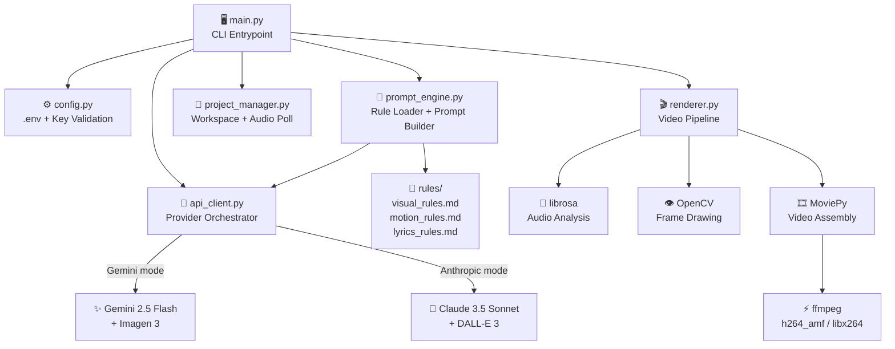
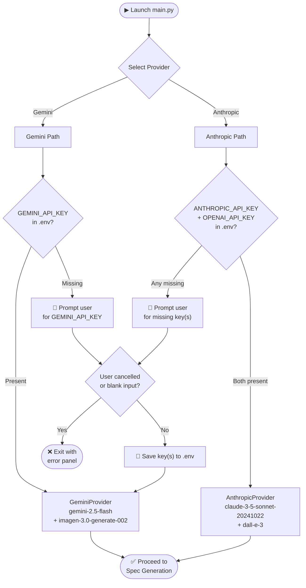
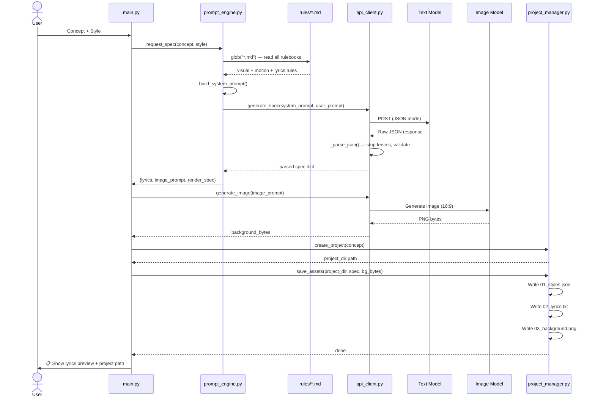
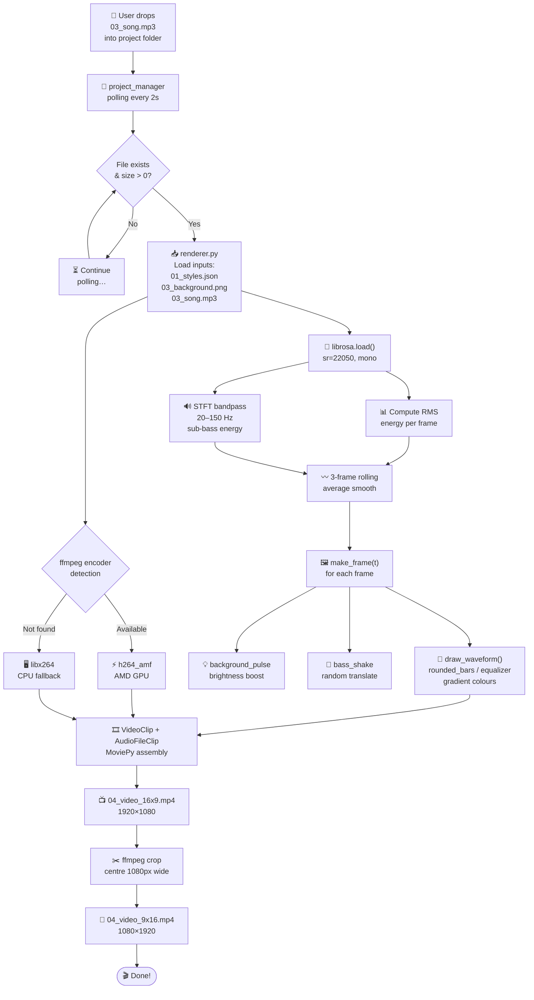
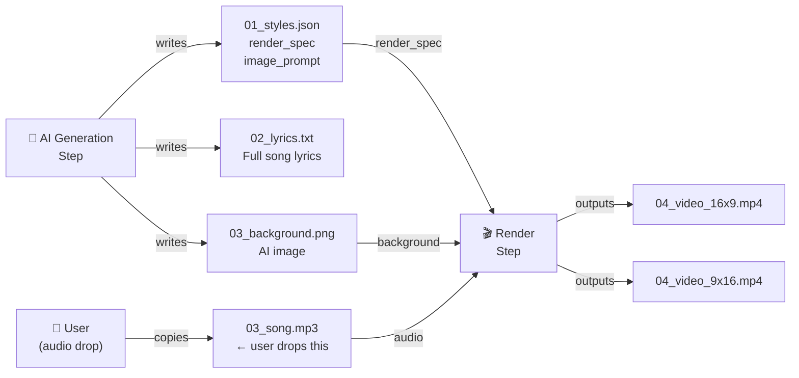
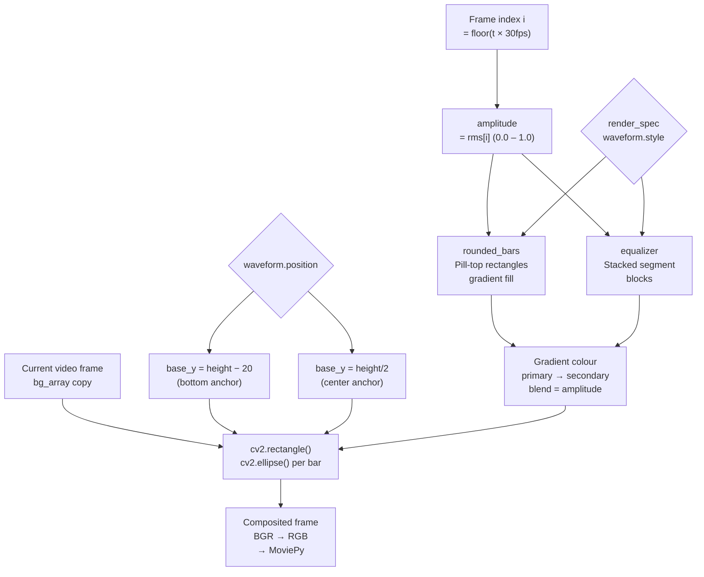
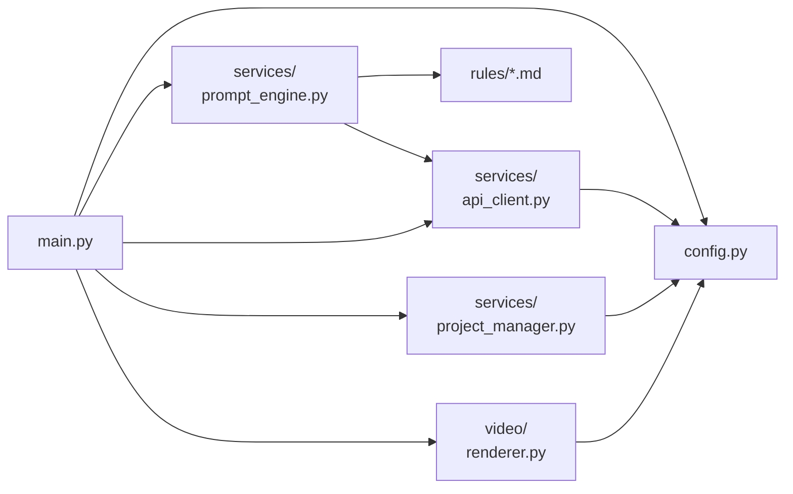

# 🗺️ Architecture & Flow Diagrams

Technical reference for **Diryan's Factory Music** — how all the pieces fit together.

---

## 1. High-Level Architecture

---

## 2. Provider Decision Flow

---

## 3. AI Generation Pipeline

---

## 4. Audio-Drop & Render Pipeline

---

## 5. Project Folder Data Flow

---

## 6. Waveform Drawing Logic

---

## Module Dependency Map

