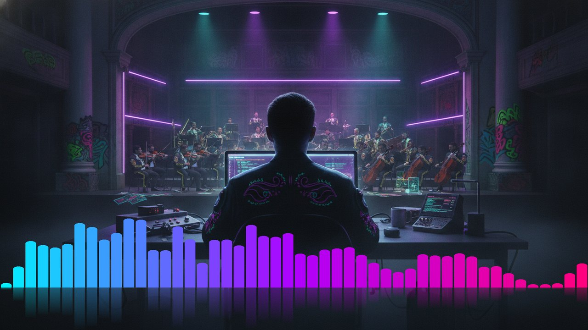
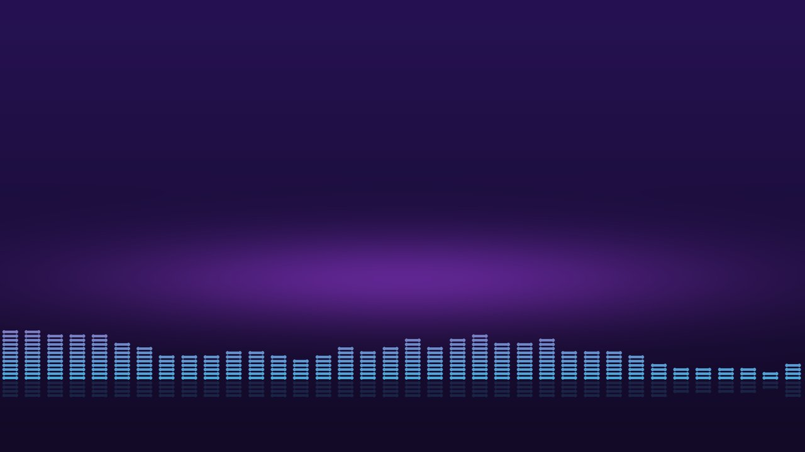
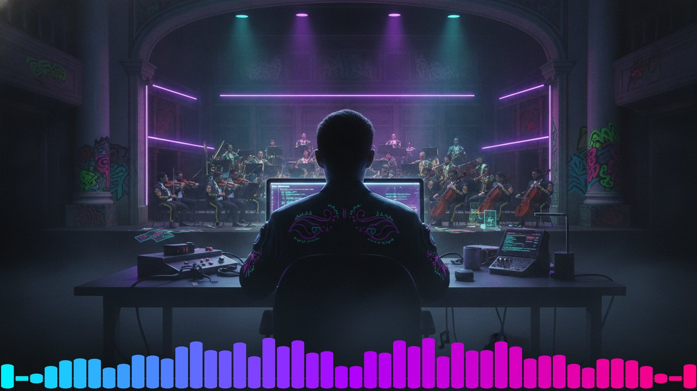
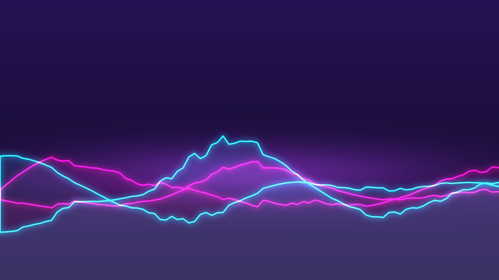
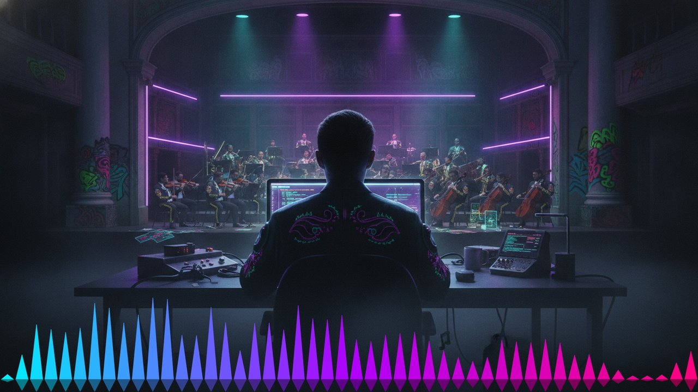
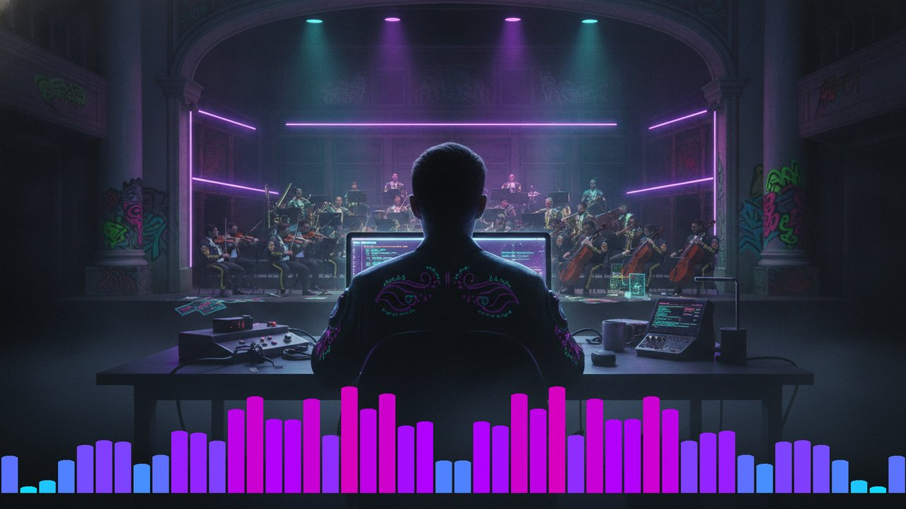
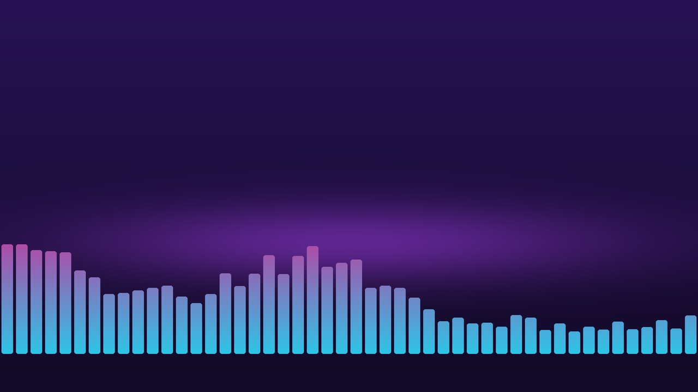
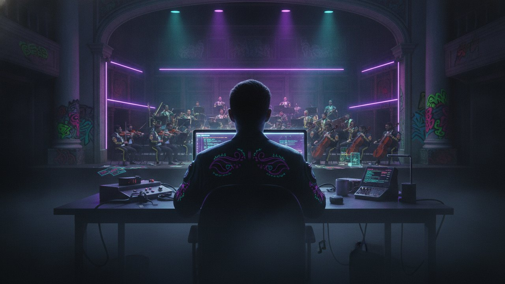

# 📖 Usage Guide

Complete walkthrough for using **Diryan's Factory Music** from first launch to final video export.

---

## Starting the App

```powershell
cd "c:\Users\t18\Documents\personal\Diryan's music factory\Diryans_factory_music"
.\.venv\Scripts\Activate.ps1
python main.py
```

---

## Step 1 — Select Your AI Provider

On launch you'll see a selection menu:

```
? Select your AI provider:
  ❯ ✨ Gemini  (Default — Gemini + Imagen 3)
    🤖 Anthropic  (Claude + DALL·E 3)
```

Use arrow keys and press **Enter** to confirm.

| Provider | Text Model | Image Model | Keys Needed |
|---|---|---|---|
| **Gemini** | `gemini-2.5-flash` | `imagen-3.0-generate-002` | `GEMINI_API_KEY` |
| **Anthropic** | `claude-3-5-sonnet-20241022` | `dall-e-3` | `ANTHROPIC_API_KEY` + `OPENAI_API_KEY` |

---

## Step 2 — API Key Validation

The app checks your `.env` file for the required keys.

**If a key is found:** validation passes silently — nothing to do.

**If a key is missing:** you'll see a prompt like:

```
⚠  GEMINI_API_KEY is not set in your environment or .env file.
? Paste your GEMINI_API_KEY: ••••••••
✔  GEMINI_API_KEY saved to .env
```

- Input is **masked** — your key is never shown in the terminal.
- The key is saved to `.env` automatically for future runs.
- If you press **Ctrl+C** or leave it blank, the app exits gracefully with a clear error.

---

## Step 3 — Describe Your Song

```
? Describe your song concept: A late-night drive through a glowing city, feeling infinite
? Genre / style / vibe: Lo-fi Hip-Hop
```

**Concept tips:**
- Be descriptive — the more vivid, the better the lyrics and image.
- Mention a mood, setting, or story you want conveyed.
- The concept also influences the background image generation prompt.

**Style tips:**
- Any genre works: `Trap`, `R&B`, `EDM`, `Pop`, `Indie`, `Jazz`, `Drill`, etc.
- You can layer descriptors: `"Dark Trap with orchestral strings"`

---

## Step 4 — AI Spec Generation

The app sends your concept to the selected LLM with a system prompt built from all three rulebooks (`visual_rules.md`, `motion_rules.md`, `lyrics_rules.md`).

The LLM returns a single JSON object with:

```json
{
  "lyrics": "[Verse 1]\n...\n[Chorus]\n...",
  "image_prompt": "A cinematic night cityscape...",
  "render_spec": {
    "waveform": {
      "style": "rounded_bars",
      "position": "bottom",
      "primary_color": "#A78BFA",
      "secondary_color": "#06B6D4",
      "bar_count": 52
    },
    "motion_effects": {
      "bass_shake": true,
      "shake_intensity_px": 3,
      "background_pulse": true
    }
  }
}
```

A **lyrics preview** is printed to the terminal after generation.

---

## Step 5 — Background Image Generation

The image prompt from Step 4 is sent to the image model:

- **Gemini:** Imagen 3 generates a native 16:9 image.
- **Anthropic:** DALL-E 3 generates a 1792×1024 image (closest HD 16:9 size).

The image is saved as `03_background.png` in your project folder.

---

## Step 6 — Project Folder

A new folder is created under `projects/` named after the **song title the AI generated** (not your concept). While the AI is still writing, it lives in a temporary `projects/_draft_<concept>/` folder that is renamed as soon as the title is known:

```
projects/neon_infinito/
├── 01_styles.json       ← render_spec + image_prompt
├── 02_lyrics.txt        ← full lyrics
└── 03_background.png    ← AI background image
```

The terminal prints the full path and waits:

```
╭─── 🎵 Waiting for Audio ────────────────────────────────────────╮
│                                                                  │
│  Drop your audio file into the project folder:                  │
│                                                                  │
│    projects\late_night_drive...\03_song.mp3                     │
│                                                                  │
│  The renderer will start automatically once the file is         │
│  detected.                                                       │
╰──────────────────────────────────────────────────────────────────╯
⠸ Polling for 03_song.mp3…
```

---

### `Data.txt` — ready-to-paste YouTube & TikTok copy

| Section | Field | Notes |
|---|---|---|
| 🎬 YouTube | `TITLE` | ≤ 100 chars, song title first + genre keywords, max 1 emoji |
| | `DESCRIPTION` | Hook line first (≤ 150 chars, shown above "Show more"), then story, 🎵 lyrics, 🎧 credits, 🔔 call to action, hashtags |
| | `TAGS` | Paste into YouTube Studio → Tags (comma-separated, ≤ 500 chars) |
| 📱 TikTok | `CAPTION` | ≤ 150 chars, max 2 emojis, followed by 3 topic hashtags + `#corridosenhtml #musicadela403` |

Emojis are capped automatically, so the copy stays clean even if the AI gets carried away. Use **📝 Regenerate Data.txt** in the post-render menu to rebuild it from the saved spec (0 tokens) or ask the AI for fresh copy.

---

## Step 7 — Drop Your Audio File

Copy or move your MP3 file into the project folder and **rename it `03_song.mp3`**.

> [!TIP]
> You can use any MP3 — one you recorded, exported from a DAW, or downloaded. The renderer reads it with `librosa` regardless of bitrate or sample rate.

The CLI will detect the file within 2 seconds and move on automatically.

---

## Step 8 — Video Rendering

The renderer runs in three stages:

### Stage 1 — Audio Analysis
`librosa` loads the MP3 and computes:
- **Overall RMS energy** per frame (drives waveform height)
- **Sub-bass energy (20–150 Hz)** per frame (drives screen shake)
- Both arrays are smoothed with a 3-frame rolling average

### Stage 2 — Frame Rendering (OpenCV + MoviePy)
For each of the ~5,400 frames in a 3-minute video:
1. Copy the background image
2. Apply background pulse (if enabled)
3. Apply bass shake translation (if enabled + sub-bass threshold exceeded)
4. Draw waveform bars with gradient colouring

A progress bar shows real-time frame count and ETA.

### Stage 3 — Export
- **`04_video_16x9.mp4`** — full 1920×1080 render, AAC audio
- **`04_video_9x16.mp4`** — centre-cropped 1080×1920 portrait version

Encoding uses `h264_amf` (AMD GPU) or `libx264` (CPU fallback).

---

## Final Output

```
╔══════════════════════════════════════════════════════════════╗
║  🎬 Render Complete                                          ║
║                                                              ║
║  ✅ All done!                                                ║
║                                                              ║
║  📺 Landscape : projects\...\04_video_16x9.mp4               ║
║  📱 Portrait  : projects\...\04_video_9x16.mp4               ║
║  📁 Project   : projects\late_night_drive_through_...        ║
╚══════════════════════════════════════════════════════════════╝
```

---

## Waveform Style Reference

These are the options in the **"Select waveform visual style (form):"** menu. Each example is a real frame from the renderer, using the *Synthwave Neon* palette with `bottom` position.

| Style | Example |
|---|---|
| `rounded_mirror` — ✨ Capsule bars with water reflection |  |
| `dot_matrix` — 🟣 Halftone LED dot matrix |  |
| `neon_ladder` — 🎛️ Neon segmented ladder with floor reflection |  |
| `center_symmetrical` — ⚡ Double-sided center soundwave |  |
| `flowing_ribbons` — 〰️ Glowing sine wave ribbons |  |
| `sharp_spikes` — 📐 Cyber polygon spikes |  |
| `mirrored_bars` — 📊 Classic mirrored spectrum (bass in center) |  |
| `frequency_bars` — 📈 Classic frequency bars (bass → treble) |  |
| `none` — 🚫 Clean (shake & pulse only) |  |

Regenerate the examples after changing the renderer:

```powershell
# Synthetic background & spectrum (no project needed)
python scripts/generate_style_examples.py

# Real background art + most dynamic frame of a project's song
python scripts/generate_style_examples.py --project projects/<your_project>

# Custom colours, or sample them from the project background
python scripts/generate_style_examples.py --project projects/<your_project> --palette auto
```

## Position Reference

| Position | Description |
|---|---|
| `bottom` | Lower 20% of frame — leaves composition space, waveform never covers the subject |
| `center` | Vertically centered — dramatic on abstract / symmetrical backgrounds |

---

## Tips & Best Practices

- **Use high-quality MP3s (192 kbps+)** — librosa analysis is more accurate with cleaner audio.
- **Tracks with clear bass hits** produce the most dynamic shake and pulse effects.
- **Re-run with different styles** — change the style prompt to get a completely different render spec from the AI.
- **Edit `01_styles.json` manually** before rendering to tweak colours, bar count, or effects without regenerating from the LLM.
- **The `projects/` folder is permanent** — each run creates a new uniquely named subfolder, so nothing is overwritten.

---

## Troubleshooting

| Problem | Fix |
|---|---|
| `PermissionError` on `.env` | Run terminal as a regular user, not admin |
| `librosa` import error | Run `pip install librosa soundfile` explicitly |
| Video renders but has no audio | Ensure the MP3 is valid and not corrupted |
| Shake effect too strong | Edit `shake_intensity_px` in `01_styles.json` before rendering |
| DALL-E 3 content policy refusal | Rephrase the concept to be less abstract; avoid keywords that trigger filters |
| `ModuleNotFoundError: cv2` | Run `pip install opencv-python` |

